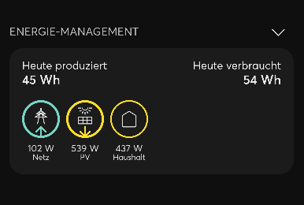
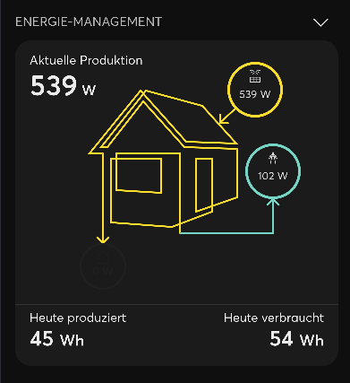
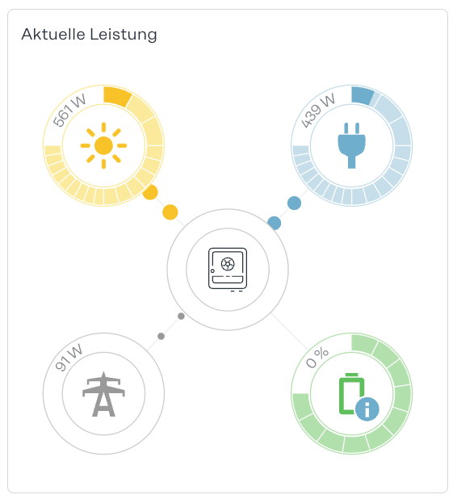

# Fronius Wechselrichter für free@home

Ein free@home Add-On, das die Live-Daten eines Fronius Wechselrichters und des Fronius Smart Meters ausliest und als Energiegeräte in free@home bereitstellt. So erscheinen PV-Erzeugung, Netzbezug und Einspeisung direkt im Energiemonitor der free@home App.

- **Add-On-ID:** `de.julian-gilles.fronius`
- **Autor:** Julian Gilles
- **Lizenz:** MIT

🇬🇧 **English version:** [see below](#english)

---

## Inhalt

1. [Funktionen](#funktionen)
2. [Voraussetzungen](#voraussetzungen)
3. [Installation](#installation)
4. [Einstellungen](#einstellungen)
5. [Geräte und Werte in free@home](#geräte-und-werte-in-freehome)
6. [Ansicht in free@home](#ansicht-in-freehome)
7. [Funktionsweise](#funktionsweise)
8. [Fehlersuche](#fehlersuche)
9. [Entwicklung](#entwicklung)
10. [Lizenz](#lizenz)
11. [English](#english)

---

## Funktionen

- Liest die **Fronius Solar API v1** lokal im Netzwerk aus. Eine Cloud oder ein Fronius-Konto ist nicht nötig.
- Legt drei virtuelle Geräte in free@home an:
  - **Fronius Wechselrichter:** PV-Leistung, Tages- und Gesamtertrag, Eigenverbrauch und Autarkie
  - **Fronius Smart Meter:** Netzleistung, Überschuss, Bezug und Einspeisung (heute und gesamt)
  - **Fronius Hausverbrauch:** aktueller Verbrauch des Hauses, Verbrauch heute und gesamt
- Berechnet die Tageswerte selbst, falls der Wechselrichter keine liefert (z. B. beim GEN24).
- Meldet die Geräte als *nicht erreichbar*, wenn der Wechselrichter nicht antwortet, und stellt sie automatisch wieder her.
- IP-Adresse, Port und Abfrageintervall lassen sich in der free@home-Oberfläche einstellen.

Getestet mit einem **Fronius GEN24** und einem **Fronius Smart Meter 63A** (ohne Batterie).

## Voraussetzungen

| Komponente | Anforderung |
|---|---|
| free@home | System Access Point (SysAP) ab Version 3.0.0 mit Add-On-Unterstützung |
| Fronius | Wechselrichter mit Solar API v1 (z. B. GEN24, Symo, Primo mit Datamanager) |
| Netzwerk | SysAP und Wechselrichter müssen sich im Netz erreichen |
| Smart Meter | optional; ohne Smart Meter bleiben die Netzwerte leer |

**Solar API aktivieren:** Bei neueren Fronius-Geräten ist die Solar API ab Werk oft deaktiviert. Aktiviere sie in der Weboberfläche des Wechselrichters unter *Kommunikation → Solar API*.

Ob die API erreichbar ist, kannst du im Browser prüfen:

```
http://192.168.150.10:8080/solar_api/v1/GetPowerFlowRealtimeData.fcgi
```

Liefert die Adresse JSON-Daten, ist alles bereit.

## Installation

1. Lade das Add-On-Paket `de.julian-gilles.fronius-<version>.tar` herunter oder baue es selbst (siehe [Paket bauen](#paket-bauen)).
2. Öffne die Weboberfläche des SysAP und wechsle in den Bereich für Add-Ons. Für eigene Add-Ons muss der Entwicklermodus aktiviert sein.
3. Lade die `.tar`-Datei hoch und installiere das Add-On.
4. Öffne das Add-On **Fronius Wechselrichter** und prüfe die [Einstellungen](#einstellungen).
5. Stelle den Status auf **Aktiv**.

Danach erscheinen die Geräte *Fronius Wechselrichter*, *Fronius Smart Meter* und *Fronius Hausverbrauch* in free@home. Dort kannst du sie wie gewohnt einem Raum zuordnen.

## Einstellungen


| Einstellung | Beschreibung | Standard | Bereich |
|---|---|---|---|
| **IP-Adresse Wechselrichter** | IP-Adresse des Fronius Wechselrichters im lokalen Netz | `192.168.150.10` | gültige IPv4-Adresse |
| **HTTP-Port** | Port der Fronius-Weboberfläche bzw. Solar API | `8080` | 1–65535 |
| **Abfrageintervall (Sekunden)** | Abstand zwischen zwei Abfragen | `10` | 2–300 |

Änderungen werden sofort übernommen, das Add-On muss nicht neu gestartet werden.

> **Tipp:** Die meisten Fronius-Geräte nutzen Port `80`. Ein anderer Port wie `8080` ist nur nötig, wenn der Wechselrichter so eingerichtet ist oder hinter einer Portweiterleitung steht. Ein Intervall von 10 bis 30 Sekunden ist für den Energiemonitor völlig ausreichend und belastet den Wechselrichter kaum.

## Geräte und Werte in free@home

### Fronius Wechselrichter

| Wert in free@home | Quelle (Solar API) | Einheit |
|---|---|---|
| Aktuelle Leistung | Summe `Inverters[].P` (AC-Leistung) | W |
| Ertrag heute | `E_Day` oder berechnet aus `E_Total` | Wh |
| Ertrag gesamt | `E_Total` | kWh |
| Eigenverbrauch | `Site.rel_SelfConsumption` | % |
| Autarkie | `Site.rel_Autonomy` | % |

Die Leistung wird positiv gemeldet. Die SDK-Doku beschreibt für Wechselrichter zwar Werte ≤ 0 W, der SysAP zeigt dann aber eine negative Produktion an und berechnet den Haushalt falsch.

### Fronius Smart Meter

| Wert in free@home | Quelle (Solar API) | Einheit |
|---|---|---|
| Aktuelle Leistung | `Site.P_Grid` | W |
| Überschuss | `max(0, −P_Grid)` | W |
| Bezug heute | berechnet aus `EnergyReal_WAC_Sum_Consumed` | Wh |
| Einspeisung heute | berechnet aus `EnergyReal_WAC_Sum_Produced` | Wh |
| Bezug gesamt | `EnergyReal_WAC_Sum_Consumed` | kWh |
| Einspeisung gesamt | `EnergyReal_WAC_Sum_Produced` | kWh |

**Vorzeichen der Netzleistung:** positiv = Bezug aus dem Netz, negativ = Einspeisung ins Netz (wie bei Fronius). free@home berechnet den Haushalt als Netz + PV.

Gibt es mehrere Zähler, verwendet das Add-On den Zähler am Einspeisepunkt (`Meter_Location_Current = 0`).

### Fronius Hausverbrauch

| Wert in free@home | Quelle (Solar API) | Einheit |
|---|---|---|
| Aktuelle Leistung | `Site.P_Load` (Betrag) | W |
| Verbrauch heute | PV heute + Bezug heute − Einspeisung heute | Wh |
| Verbrauch gesamt | PV gesamt + Bezug gesamt − Einspeisung gesamt | kWh |

Fronius hat keinen eigenen Zähler für den Hausverbrauch, deshalb wird die Energie aus den anderen Zählern berechnet. Das gilt für Anlagen ohne Batterie. Der Gesamtwert wird nie kleiner gesendet als zuvor, weil der PV-Zähler seltener aktualisiert wird als das Smart Meter. Die Detailansicht im Energie-Management zeigt den Haushaltskreis nur mit diesem Gerät an, ohne bleibt er grau bei 0 W.

## Ansicht in free@home

Im **Energie-Management** der free@home App erscheinen Netz, PV und der daraus berechnete Haushaltsverbrauch:

<p>
  
  
</p>

Die Detailansicht zeigt den Energiefluss: Die PV-Erzeugung fließt ins Haus, der Überschuss wird ins Netz eingespeist (Pfeil vom Haus zum Netz). Bei Netzbezug zeigt der Pfeil vom Netz ins Haus.

### Vergleich mit der Fronius-Ansicht



Die gleiche Situation in der Weboberfläche des Fronius Wechselrichters:

| | Fronius | free@home |
|---|---|---|
| PV | 561 W | 539 W |
| Netz | 91 W Einspeisung | 102 W Einspeisung |
| Haushalt | 439 W | 437 W |

Kleine Abweichungen sind normal: Die Ansichten wurden nicht exakt gleichzeitig aufgenommen, und Fronius zeigt die PV-Leistung vor dem Wechselrichter (DC), das Add-On meldet die AC-Leistung danach.

## Funktionsweise

```
┌──────────────────┐   HTTP (Solar API v1)   ┌──────────────┐   free@home API   ┌──────────────┐
│ Fronius          │ ◄────────────────────── │ Add-On       │ ────────────────► │ free@home    │
│ Wechselrichter   │                         │ (auf SysAP)  │                   │ Energiegeräte│
│ + Smart Meter    │                         └──────────────┘                   └──────────────┘
└──────────────────┘
```

In jedem Abfrageintervall ruft das Add-On diese Endpunkte ab:

| Endpunkt | Zweck |
|---|---|
| `/solar_api/v1/GetPowerFlowRealtimeData.fcgi` | Leistungen, Autarkie, Eigenverbrauch, Gesamtertrag |
| `/solar_api/v1/GetMeterRealtimeData.cgi?Scope=System` | Zählerstände des Smart Meters |
| `/solar_api/v1/GetInverterRealtimeData.cgi?Scope=Device&DeviceId=1&DataCollection=CommonInverterData` | Status des Wechselrichters |

### Tageswerte

Der GEN24 liefert keinen Tagesertrag (`E_Day` ist `null`), und das Smart Meter kennt nur Gesamtzählerstände. Das Add-On merkt sich deshalb den Zählerstand zu Tagesbeginn und rechnet die Tageswerte als Differenz aus.

- Der Startwert wird in `daily-energy.json` gespeichert und übersteht so einen Neustart des Add-Ons.
- Um Mitternacht (Ortszeit des SysAP) beginnen die Tageswerte wieder bei 0.
- Wird das Add-On zum ersten Mal im Lauf des Tages gestartet, zählen die Tageswerte erst ab diesem Zeitpunkt.
- Liefert der Wechselrichter selbst einen Tagesertrag, wird dieser verwendet.

### Verbindungsabbruch

Antwortet der Wechselrichter nicht (z. B. nachts im Standby oder bei Netzwerkproblemen), werden beide Geräte in free@home als *nicht erreichbar* markiert. Sobald wieder Daten kommen, werden sie automatisch wieder aktiv.

## Fehlersuche

Im Tab **Protokoll** des Add-Ons stehen die Meldungen des Add-Ons:

| Meldung | Bedeutung / Lösung |
|---|---|
| `Verbunden mit Fronius <ip>:<port>` | Verbindung steht, alles in Ordnung. |
| `Fronius-Abfrage fehlgeschlagen: Timeout …` | Wechselrichter nicht erreichbar. IP-Adresse und Port prüfen und testen, ob der SysAP den Wechselrichter im Netz erreicht. |
| `Fronius-Abfrage fehlgeschlagen: HTTP 404 …` | Solar API nicht aktiviert oder falscher Port. |
| `Fronius-Abfrage fehlgeschlagen: connect ECONNREFUSED …` | Falscher Port oder Weboberfläche des Wechselrichters deaktiviert. |
| `Konfiguration: { … }` | Neue Einstellungen wurden übernommen. |

**Netzwerte bleiben leer:** Es ist kein Fronius Smart Meter angeschlossen, oder es ist nicht als Zähler am Einspeisepunkt konfiguriert.

**Tageswerte stimmen nicht:** Wurde das Add-On im Lauf des Tages zum ersten Mal gestartet, zählen die Werte erst ab diesem Zeitpunkt. Ab dem nächsten Tag sind sie korrekt.

## Entwicklung

### Projektstruktur

```
├── free-at-home-metadata.json   # Add-On-Beschreibung und Einstellungen
├── package.json
├── tsconfig.json
├── src/
│   ├── main.ts                  # Einstiegspunkt: Geräte anlegen, Abfrage, Konfiguration
│   ├── fronius.ts               # Client für die Fronius Solar API v1
│   ├── dailyEnergy.ts           # Tageswerte aus Zählerständen berechnen
│   └── probe.ts                 # Testskript: nur Fronius abfragen
└── docs/images/                 # Screenshots für diese Doku
```

### Befehle

| Befehl | Beschreibung |
|---|---|
| `npm install` | Abhängigkeiten installieren |
| `npm run build` | TypeScript nach `build/` übersetzen |
| `npm run probe -- [ip] [port]` | Nur den Wechselrichter abfragen und die Werte ausgeben, ohne SysAP |
| `npm run dev` | Bauen und lokal gegen den SysAP starten |
| `npm run validate` | `free-at-home-metadata.json` prüfen |
| `npm run pack` | Add-On-Paket (`.tar`) bauen |

### Wechselrichter testen

```bash
npm run probe -- 192.168.150.10 8080
```

### Lokal gegen den SysAP laufen lassen

Die lokale API muss im SysAP aktiviert sein. Das Add-On läuft dann auf deinem Rechner, die Geräte erscheinen aber im SysAP.

```bash
export FREEATHOME_BASE_URL=http://<sysap-ip>
export FREEATHOME_API_USERNAME=installer
export FREEATHOME_API_PASSWORD=<passwort>
npm run dev
```

### Paket bauen

```bash
npm run pack
```

Das erzeugt `de.julian-gilles.fronius-<version>.tar` im Projektordner. Für ein neues Release erhöhst du die `version` in `free-at-home-metadata.json` und in `package.json`.

## Lizenz

MIT – siehe [LICENSE](LICENSE). © 2026 Julian Gilles

---

## English

A free@home add-on that reads live data from a Fronius inverter and the Fronius Smart Meter and provides them as energy devices in free@home. PV production, grid import and grid feed-in show up directly in the energy monitor of the free@home app.

- **Add-on ID:** `de.julian-gilles.fronius`
- **Author:** Julian Gilles
- **License:** MIT

### Features

- Reads the **Fronius Solar API v1** locally. No cloud or Fronius account required.
- Creates three virtual devices in free@home:
  - **Fronius Wechselrichter** (inverter): PV power, energy today and total, self-consumption and self-sufficiency
  - **Fronius Smart Meter** (grid meter): grid power, excess power, imported and exported energy (today and total)
  - **Fronius Hausverbrauch** (household meter): current household consumption, consumption today and total
- Calculates daily values itself if the inverter doesn't provide them (e.g. GEN24).
- Marks the devices as *unresponsive* when the inverter doesn't answer and recovers automatically.
- IP address, port and polling interval are configurable in the free@home UI.

Tested with a **Fronius GEN24** and a **Fronius Smart Meter 63A** (no battery).

### Requirements

| Component | Requirement |
|---|---|
| free@home | System Access Point (SysAP) 3.0.0 or newer with add-on support |
| Fronius | Inverter with Solar API v1 (e.g. GEN24, Symo, Primo with Datamanager) |
| Network | SysAP must be able to reach the inverter |
| Smart Meter | optional; without it the grid values stay empty |

**Enable the Solar API:** On newer Fronius devices the Solar API is often disabled by default. Enable it in the inverter's web interface under *Communication → Solar API*. To check, open `http://<inverter-ip>:<port>/solar_api/v1/GetPowerFlowRealtimeData.fcgi` in a browser; it should return JSON.

### Installation

1. Download the add-on package `de.julian-gilles.fronius-<version>.tar` or build it yourself (`npm install && npm run pack`).
2. Open the SysAP web interface and go to the add-on section. Developer mode must be enabled for custom add-ons.
3. Upload and install the `.tar` file.
4. Open the add-on **Fronius Wechselrichter** and check the settings.
5. Set the status to **active**.

The devices *Fronius Wechselrichter*, *Fronius Smart Meter* and *Fronius Hausverbrauch* then appear in free@home and can be assigned to a room.

### Settings

| Setting | Description | Default | Range |
|---|---|---|---|
| **Inverter IP address** | IP address of the Fronius inverter | `192.168.150.10` | valid IPv4 address |
| **HTTP port** | Port of the Fronius web interface / Solar API | `8080` | 1–65535 |
| **Polling interval (seconds)** | Time between two queries | `10` | 2–300 |

Changes are applied immediately. Most Fronius devices use port `80`; an interval of 10–30 seconds is sufficient.

### Values and sign conventions

| Device | Value | Source (Solar API) |
|---|---|---|
| Inverter | Current power (positive) | sum of `Inverters[].P` (AC) |
| Inverter | Energy today / total | `E_Day` or calculated from `E_Total` |
| Inverter | Self-consumption / self-sufficiency | `Site.rel_SelfConsumption` / `Site.rel_Autonomy` |
| Grid meter | Current power | `Site.P_Grid` (> 0 import, < 0 feed-in) |
| Grid meter | Excess power | `max(0, −P_Grid)` |
| Grid meter | Imported / exported energy | `EnergyReal_WAC_Sum_Consumed` / `_Produced` |
| Household meter | Current power | `Site.P_Load` (absolute value) |
| Household meter | Consumption today / total | PV + grid import − grid feed-in (calculated) |

Fronius has no dedicated household energy counter, so the add-on calculates it from the other counters (systems without battery). The total is never sent lower than before, because the PV counter updates less often than the Smart Meter. The detail view of the energy management only shows the household circle with this device; without it, the circle stays grey at 0 W.

free@home calculates the household consumption as grid + PV. PV power is therefore sent as a **positive** value, even though the SDK documentation describes values ≤ 0 for inverters; with negative values the SysAP shows a negative production and a wrong household value. Total counters are sent as whole kWh, because the SysAP rejects decimals.

### Daily values

The GEN24 doesn't provide a daily yield (`E_Day` is `null`), and neither the Solar API archive (`GetArchiveData.cgi` returns 404 on GEN24) nor the internal web interface offers one. The add-on therefore stores the meter readings at the start of the day in `daily-energy.json` and calculates the daily values as the difference.

- Daily values survive add-on restarts and reset at midnight (SysAP local time).
- After a **new installation or update**, the daily values start at 0 again for the rest of that day.
- The GEN24 updates its total counter only every few minutes, so the PV daily value increases in steps.

### Troubleshooting

Check the **Protokoll** (log) tab of the add-on:

| Message | Meaning |
|---|---|
| `Verbunden mit Fronius <ip>:<port>` | Connected, everything fine. |
| `Fronius-Abfrage fehlgeschlagen: Timeout …` | Inverter not reachable; check IP address, port and network. |
| `Fronius-Abfrage fehlgeschlagen: HTTP 404 …` | Solar API disabled or wrong port. |
| `<Wert>: konnte nicht gesetzt werden …` | The SysAP rejected a value; the message names the value. |
| `Tageswerte gesendet: …` | Daily values sent to free@home (logged every 15 minutes). |

### Development

```bash
npm install
npm run probe -- 192.168.150.10 8080   # query the inverter only, without SysAP
npm run validate                       # validate free-at-home-metadata.json
npm run pack                           # build the add-on package (.tar)
```

To run the add-on locally against the SysAP (local API must be enabled):

```bash
export FREEATHOME_BASE_URL=http://<sysap-ip>
export FREEATHOME_API_USERNAME=installer
export FREEATHOME_API_PASSWORD=<password>
npm run dev
```

For a new release, increase `version` in `free-at-home-metadata.json` and `package.json`.

### License

MIT – see [LICENSE](LICENSE). © 2026 Julian Gilles
