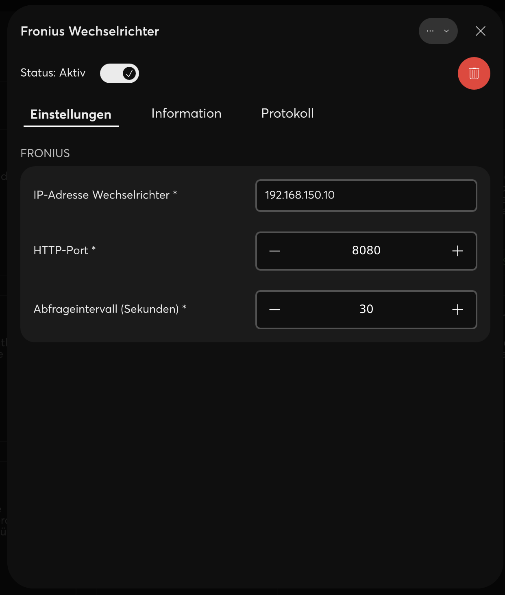

# Fronius Wechselrichter für free@home

Ein free@home Add-On, das die Live-Daten eines Fronius Wechselrichters und des Fronius Smart Meters ausliest und als Energiegeräte in free@home bereitstellt. So erscheinen PV-Erzeugung, Netzbezug und Einspeisung direkt im Energiemonitor der free@home App.

- **Add-On-ID:** `de.julian-gilles.fronius`
- **Autor:** Julian Gilles
- **Lizenz:** MIT

---

## Inhalt

1. [Funktionen](#funktionen)
2. [Voraussetzungen](#voraussetzungen)
3. [Installation](#installation)
4. [Einstellungen](#einstellungen)
5. [Geräte und Werte in free@home](#geräte-und-werte-in-freehome)
6. [Funktionsweise](#funktionsweise)
7. [Fehlersuche](#fehlersuche)
8. [Entwicklung](#entwicklung)
9. [Lizenz](#lizenz)

---

## Funktionen

- Liest die **Fronius Solar API v1** lokal im Netzwerk aus. Eine Cloud oder ein Fronius-Konto ist nicht nötig.
- Legt zwei virtuelle Geräte in free@home an:
  - **Fronius Wechselrichter:** PV-Leistung, Tages- und Gesamtertrag, Eigenverbrauch und Autarkie
  - **Fronius Smart Meter:** Netzleistung, Überschuss, Bezug und Einspeisung (heute und gesamt)
- Berechnet die Tageswerte selbst, falls der Wechselrichter keine liefert (z. B. beim GEN24).
- Meldet die Geräte als *nicht erreichbar*, wenn der Wechselrichter nicht antwortet, und stellt sie automatisch wieder her.
- IP-Adresse, Port und Abfrageintervall lassen sich in der free@home-Oberfläche einstellen.

Getestet mit einem **Fronius GEN24** und einem **Fronius Smart Meter 63A** (ohne Batterie).

## Voraussetzungen

| Komponente | Anforderung |
|---|---|
| free@home | System Access Point (SysAP) ab Version 3.0.0 mit Add-On-Unterstützung |
| Fronius | Wechselrichter mit Solar API v1 (z. B. GEN24, Symo, Primo mit Datamanager) |
| Netzwerk | SysAP und Wechselrichter müssen sich im Netz erreichen |
| Smart Meter | optional; ohne Smart Meter bleiben die Netzwerte leer |

**Solar API aktivieren:** Bei neueren Fronius-Geräten ist die Solar API ab Werk oft deaktiviert. Aktiviere sie in der Weboberfläche des Wechselrichters unter *Kommunikation → Solar API*.

Ob die API erreichbar ist, kannst du im Browser prüfen:

```
http://192.168.150.10:8080/solar_api/v1/GetPowerFlowRealtimeData.fcgi
```

Liefert die Adresse JSON-Daten, ist alles bereit.

## Installation

1. Lade das Add-On-Paket `de.julian-gilles.fronius-<version>.tar` herunter oder baue es selbst (siehe [Paket bauen](#paket-bauen)).
2. Öffne die Weboberfläche des SysAP und wechsle in den Bereich für Add-Ons. Für eigene Add-Ons muss der Entwicklermodus aktiviert sein.
3. Lade die `.tar`-Datei hoch und installiere das Add-On.
4. Öffne das Add-On **Fronius Wechselrichter** und prüfe die [Einstellungen](#einstellungen).
5. Stelle den Status auf **Aktiv**.

Danach erscheinen die Geräte *Fronius Wechselrichter* und *Fronius Smart Meter* in free@home. Dort kannst du sie wie gewohnt einem Raum zuordnen.

## Einstellungen



| Einstellung | Beschreibung | Standard | Bereich |
|---|---|---|---|
| **IP-Adresse Wechselrichter** | IP-Adresse des Fronius Wechselrichters im lokalen Netz | `192.168.150.10` | gültige IPv4-Adresse |
| **HTTP-Port** | Port der Fronius-Weboberfläche bzw. Solar API | `8080` | 1–65535 |
| **Abfrageintervall (Sekunden)** | Abstand zwischen zwei Abfragen | `10` | 2–300 |

Änderungen werden sofort übernommen, das Add-On muss nicht neu gestartet werden.

> **Tipp:** Die meisten Fronius-Geräte nutzen Port `80`. Ein anderer Port wie `8080` ist nur nötig, wenn der Wechselrichter so eingerichtet ist oder hinter einer Portweiterleitung steht. Ein Intervall von 10 bis 30 Sekunden ist für den Energiemonitor völlig ausreichend und belastet den Wechselrichter kaum.

## Geräte und Werte in free@home

### Fronius Wechselrichter

| Wert in free@home | Quelle (Solar API) | Einheit |
|---|---|---|
| Aktuelle Leistung | Summe `Inverters[].P` (AC-Leistung) | W |
| Ertrag heute | `E_Day` oder berechnet aus `E_Total` | Wh |
| Ertrag gesamt | `E_Total` | kWh |
| Eigenverbrauch | `Site.rel_SelfConsumption` | % |
| Autarkie | `Site.rel_Autonomy` | % |

Die Leistung wird positiv gemeldet. Die SDK-Doku beschreibt für Wechselrichter zwar Werte ≤ 0 W, der SysAP zeigt dann aber eine negative Produktion an und berechnet den Haushalt falsch.

### Fronius Smart Meter

| Wert in free@home | Quelle (Solar API) | Einheit |
|---|---|---|
| Aktuelle Leistung | `Site.P_Grid` | W |
| Überschuss | `max(0, −P_Grid)` | W |
| Bezug heute | berechnet aus `EnergyReal_WAC_Sum_Consumed` | Wh |
| Einspeisung heute | berechnet aus `EnergyReal_WAC_Sum_Produced` | Wh |
| Bezug gesamt | `EnergyReal_WAC_Sum_Consumed` | kWh |
| Einspeisung gesamt | `EnergyReal_WAC_Sum_Produced` | kWh |

**Vorzeichen der Netzleistung:** positiv = Bezug aus dem Netz, negativ = Einspeisung ins Netz (wie bei Fronius). free@home berechnet den Haushalt als Netz + PV.

Gibt es mehrere Zähler, verwendet das Add-On den Zähler am Einspeisepunkt (`Meter_Location_Current = 0`).

## Funktionsweise

```
┌──────────────────┐   HTTP (Solar API v1)   ┌──────────────┐   free@home API   ┌──────────────┐
│ Fronius          │ ◄────────────────────── │ Add-On       │ ────────────────► │ free@home    │
│ Wechselrichter   │                         │ (auf SysAP)  │                   │ Energiegeräte│
│ + Smart Meter    │                         └──────────────┘                   └──────────────┘
└──────────────────┘
```

In jedem Abfrageintervall ruft das Add-On diese Endpunkte ab:

| Endpunkt | Zweck |
|---|---|
| `/solar_api/v1/GetPowerFlowRealtimeData.fcgi` | Leistungen, Autarkie, Eigenverbrauch, Gesamtertrag |
| `/solar_api/v1/GetMeterRealtimeData.cgi?Scope=System` | Zählerstände des Smart Meters |
| `/solar_api/v1/GetInverterRealtimeData.cgi?Scope=Device&DeviceId=1&DataCollection=CommonInverterData` | Status des Wechselrichters |

### Tageswerte

Der GEN24 liefert keinen Tagesertrag (`E_Day` ist `null`), und das Smart Meter kennt nur Gesamtzählerstände. Das Add-On merkt sich deshalb den Zählerstand zu Tagesbeginn und rechnet die Tageswerte als Differenz aus.

- Der Startwert wird in `daily-energy.json` gespeichert und übersteht so einen Neustart des Add-Ons.
- Um Mitternacht (Ortszeit des SysAP) beginnen die Tageswerte wieder bei 0.
- Wird das Add-On zum ersten Mal im Lauf des Tages gestartet, zählen die Tageswerte erst ab diesem Zeitpunkt.
- Liefert der Wechselrichter selbst einen Tagesertrag, wird dieser verwendet.

### Verbindungsabbruch

Antwortet der Wechselrichter nicht (z. B. nachts im Standby oder bei Netzwerkproblemen), werden beide Geräte in free@home als *nicht erreichbar* markiert. Sobald wieder Daten kommen, werden sie automatisch wieder aktiv.

## Fehlersuche

Im Tab **Protokoll** des Add-Ons stehen die Meldungen des Add-Ons:

| Meldung | Bedeutung / Lösung |
|---|---|
| `Verbunden mit Fronius <ip>:<port>` | Verbindung steht, alles in Ordnung. |
| `Fronius-Abfrage fehlgeschlagen: Timeout …` | Wechselrichter nicht erreichbar. IP-Adresse und Port prüfen und testen, ob der SysAP den Wechselrichter im Netz erreicht. |
| `Fronius-Abfrage fehlgeschlagen: HTTP 404 …` | Solar API nicht aktiviert oder falscher Port. |
| `Fronius-Abfrage fehlgeschlagen: connect ECONNREFUSED …` | Falscher Port oder Weboberfläche des Wechselrichters deaktiviert. |
| `Konfiguration: { … }` | Neue Einstellungen wurden übernommen. |

**Netzwerte bleiben leer:** Es ist kein Fronius Smart Meter angeschlossen, oder es ist nicht als Zähler am Einspeisepunkt konfiguriert.

**Tageswerte stimmen nicht:** Wurde das Add-On im Lauf des Tages zum ersten Mal gestartet, zählen die Werte erst ab diesem Zeitpunkt. Ab dem nächsten Tag sind sie korrekt.

## Entwicklung

### Projektstruktur

```
├── free-at-home-metadata.json   # Add-On-Beschreibung und Einstellungen
├── package.json
├── tsconfig.json
├── src/
│   ├── main.ts                  # Einstiegspunkt: Geräte anlegen, Abfrage, Konfiguration
│   ├── fronius.ts               # Client für die Fronius Solar API v1
│   ├── dailyEnergy.ts           # Tageswerte aus Zählerständen berechnen
│   └── probe.ts                 # Testskript: nur Fronius abfragen
└── docs/images/                 # Bilder für diese Doku
```

### Befehle

| Befehl | Beschreibung |
|---|---|
| `npm install` | Abhängigkeiten installieren |
| `npm run build` | TypeScript nach `build/` übersetzen |
| `npm run probe -- [ip] [port]` | Nur den Wechselrichter abfragen und die Werte ausgeben, ohne SysAP |
| `npm run dev` | Bauen und lokal gegen den SysAP starten |
| `npm run validate` | `free-at-home-metadata.json` prüfen |
| `npm run pack` | Add-On-Paket (`.tar`) bauen |

### Wechselrichter testen

```bash
npm run probe -- 192.168.150.10 8080
```

### Lokal gegen den SysAP laufen lassen

Die lokale API muss im SysAP aktiviert sein. Das Add-On läuft dann auf deinem Rechner, die Geräte erscheinen aber im SysAP.

```bash
export FREEATHOME_BASE_URL=http://<sysap-ip>
export FREEATHOME_API_USERNAME=installer
export FREEATHOME_API_PASSWORD=<passwort>
npm run dev
```

### Paket bauen

```bash
npm run pack
```

Das erzeugt `de.julian-gilles.fronius-<version>.tar` im Projektordner. Für ein neues Release erhöhst du die `version` in `free-at-home-metadata.json` und in `package.json`.

## Lizenz

MIT – siehe [LICENSE](LICENSE). © 2026 Julian Gilles
